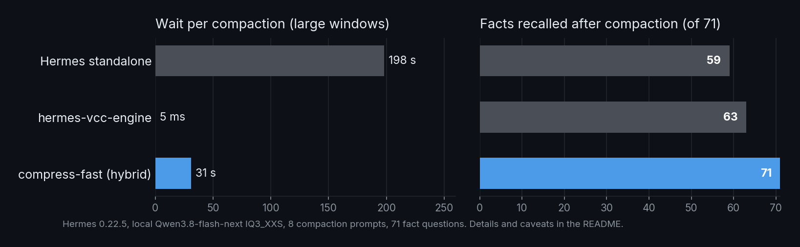

# compress-fast

Faster context compaction for [Hermes Agent](https://github.com/NousResearch/hermes-agent) on local models.

[](https://github.com/ATLAS-0321/compress-fast/actions/workflows/tests.yml)
[](LICENSE)


When a Hermes session fills its context, Hermes has the model summarize the older turns. On a
local model that single request stalls the agent for minutes. compress-fast builds the facts of
the summary by rules in milliseconds and lets the model write only the reasoning, from a small
digest.

**About 31 seconds per compaction instead of 3 minutes, and 71 of 71 facts kept instead of 59.**
No Hermes patches, no plugin hooks: a small OpenAI-compatible proxy that `auxiliary.compression`
points at.

<picture>
  <source media="(prefers-color-scheme: light)" srcset="docs/results-light.png">
  
</picture>

## Quick start

Needs Python 3.10 or newer (standard library only), an OpenAI-compatible model server (llama.cpp,
vLLM, SGLang, LM Studio, Ollama or a hosted API) and Hermes Agent 0.22.5. systemd is optional.

```bash
git clone https://github.com/ATLAS-0321/compress-fast ~/compress-fast
cd ~/compress-fast
./install.sh --upstream http://127.0.0.1:8080 --model <model name>
```

`--upstream` is your model server without `/v1`, `--model` the name it lists under `/v1/models`.
The script writes `~/.config/compress-fast/env`, starts the user service `compress-fast.service`
on port 8091 and prints the block for `~/.hermes/config.yaml`:

```yaml
auxiliary:
  compression:
    provider: custom
    model: <model name>
    base_url: http://127.0.0.1:8091/v1
    timeout: 120
```

Restart Hermes afterwards. Hermes reads the auxiliary settings when a session starts, so only new
sessions use compress-fast.

For a hosted API, add `api_key: <your key>` to the block. compress-fast passes the key on to the
model server; without it Hermes sends the placeholder `no-key-required` and the API refuses it.

Without systemd, skip `install.sh` (it needs `systemctl`), start the server from the checkout and
add the block above by hand:
`cd ~/compress-fast && COMPRESS_FAST_UPSTREAM=http://127.0.0.1:8080 python3 -m compress_fast.server`

## How it works

compress-fast recognizes Hermes' compaction prompt and builds the summary itself:

- **Facts by rules, in milliseconds.** Every tool call with its target and outcome, errors and
  whether a later retry worked, files read and written, the user's instructions verbatim, the
  agent's notes between tool calls, memory-provider context.
- **Reasons by the model** (`hybrid`, the default). The model writes four short sections (current
  state, decisions, errors and fixes, constraints) from a compact digest instead of the whole
  window, with reasoning off and the answer capped at 1100 tokens. If the call fails or runs into
  the timeout, whatever it finished is used and the rules cover the rest.
- **Within Hermes' size target.** The summary is fitted to the token target in the prompt.
  Material repeated elsewhere shrinks first; older actions keep a short line with their outcome,
  and the user's goal and the model's text are never cut.

Everything else (normal chat, streaming, `/v1/models`, any prompt it cannot parse safely) goes to
your model server unchanged. If a Hermes update changes the prompt text, compress-fast stops
recognizing it and Hermes gets the model's summary as before.

## Results

Hermes 0.22.5 with Qwen3.8-flash-next (IQ3_XXS) served locally on one AMD RX 7900 XTX (about
550 tokens/s prompt reading, 45-50 tokens/s generation). Eight real compaction prompts, four of
them large windows of 100-166k chars. After each summary the same model answered a quiz from that
summary alone: 71 fact questions and 24 negative controls (a made-up file, error or word).

| Variant | Facts (of 71) | Wrong facts | False claims (of 24) | Time per compaction | Size, large windows |
|---|---|---|---|---|---|
| Hermes standalone (model summary) | 59 | 2 | 0 | 42-229 s | ~5.9k tokens |
| [hermes-vcc-engine](https://github.com/danbiocchi/hermes-vcc-engine) 0.4.3 | 63 | 2 | 0 | ~5 ms | ~8.6k tokens |
| compress-fast (hybrid) | 71 | 0 | 0 | 10-39 s | ~6.9k tokens |

- A fact counts by exact answer. A control fails only when the model claims the made-up thing
  happened; "unknown" passes, since no summary can prove that a script did not touch some file.
- The questions come from compress-fast's own extractor, which favors it somewhat. One generated
  question counts for no variant: its command prefix fit two calls that ended differently.
- The quiz checks facts, not reasons. Hermes standalone and compress-fast also keep why decisions
  were made; VCC does not. VCC ran on the pruned prompt text; inside Hermes it sees the full
  messages.
- Sizes are measured with the model's tokenizer against a 7k target. Single windows ran up to 14 %
  over when the reasoning answer reached its cap; 0.3.0 ran up to 84 % over.
- Rules only (`COMPRESS_FAST_MODE=serve`, no model call) got the same 71 facts in 1-47 ms.
- A faster GPU shortens every model call. Recall does not depend on it.

## Configuration

Environment variables, for the service in `~/.config/compress-fast/env`:

| Variable | Default | Meaning |
|---|---|---|
| `COMPRESS_FAST_UPSTREAM` | `http://127.0.0.1:8080` | Model server base URL, without `/v1` |
| `COMPRESS_FAST_HOST` / `COMPRESS_FAST_PORT` | `127.0.0.1` / `8091` | Listen address |
| `COMPRESS_FAST_MODE` | `hybrid` | `hybrid`, `serve` (rules only) or `shadow` (compare, see below) |
| `COMPRESS_FAST_HYBRID_TIMEOUT` | `90` | Seconds for the reasoning call; unfinished sections stay rules only |
| `COMPRESS_FAST_HYBRID_MAX_TOKENS` | `1100` | Token cap for the reasoning answer |
| `COMPRESS_FAST_HYBRID_EXTRA_BODY` | empty | Extra JSON fields for the reasoning call |
| `COMPRESS_FAST_MODEL` | empty | Model for the reasoning call if a request names none |
| `COMPRESS_FAST_UPSTREAM_TIMEOUT` | `1800` | Timeout for forwarded requests |
| `COMPRESS_FAST_SHADOW_DIR` | `~/.hermes/compress-fast-shadow` | Where shadow mode stores pairs |

The reasoning call sends `chat_template_kwargs: {enable_thinking: false}`. `EXTRA_BODY` adds
server-specific fields, for example a sampling parameter like `{"top_k": 20}`. It must be a JSON
object without `model`, `messages` or `stream`, otherwise the service refuses to start. In the env
file it goes in as is; in a shell, quote it: `export COMPRESS_FAST_HYBRID_EXTRA_BODY='{"top_k": 20}'`.
A server that rejects these fields gets the request again without them.

The `Authorization` header is passed through, also to the reasoning call, and HTTPS upstreams work.

## Try it on your own sessions

`COMPRESS_FAST_MODE=shadow` changes nothing for Hermes: every compaction still goes to your model.
compress-fast also builds its own summary and stores prompt, rule summary and model summary side by
side (directory 0700, files 0600). **These files contain your session content.**

```bash
python3 tools/compare_shadow.py                   # coverage and what only one side kept
python3 tools/quiz.py <stamp> --model-url http://127.0.0.1:8080/v1 --hybrid
python3 tools/quiz.py --table                     # totals over all stored quizzes
```

## Operation

```bash
curl -s 127.0.0.1:8091/compress-fast/stats        # counters and timers
tail -f ~/.hermes/logs/compress-fast.log
journalctl --user -u compress-fast -n 50
python3 -m unittest discover -s tests -v          # fake upstream, no model needed
```

The test prompts in `tests/fixtures/` come from invented sessions, built with Hermes' own prompt
builder (`tools/make_fixtures.py`). Prompts in `testdata/` (git-ignored) are tested too.

To uninstall: `systemctl --user disable --now compress-fast`, remove
`~/.config/systemd/user/compress-fast.service` and `~/.config/compress-fast`, then point
`auxiliary.compression` back at your model and restart Hermes.

## Limits

- Tied to the text of Hermes' compaction prompt. After a Hermes update that changes it, requests
  go to your model until compress-fast is updated; the `request.summary_forwarded` counter and a
  log line show it.
- The rules keep reasons only where the agent wrote them down between tool calls.
- Hybrid adds one model call per compaction: 10-39 s on the GPU above.
- In windows with many long, different commands a summary can run a few percent over the size
  target, because every action keeps its line.

## Credits

Some fact-extraction ideas came from reading
[hermes-vcc-engine](https://github.com/danbiocchi/hermes-vcc-engine) (Apache-2.0). No code was
taken from it; `tools/vcc_bridge.py` runs its projector only for the comparison above.

## License

MIT
