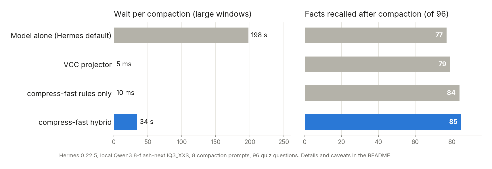

# compress-fast

Faster context compaction for [Hermes Agent](https://github.com/NousResearch/hermes-agent) on local models.

[](LICENSE)


On a local model, every Hermes compaction stalled the agent for **about 3 minutes** on large windows.
With compress-fast it takes **about 34 seconds**, and the summary keeps **more** of what happened:
85 of 96 facts instead of 77. No Hermes patches, no plugin hooks: it is a small proxy you point
`auxiliary.compression` at.



```bash
git clone https://github.com/ATLAS-0321/compress-fast && cd compress-fast
./install.sh --upstream http://127.0.0.1:8080 --model <your model>   # then paste the printed config block
```

## How it works

When a Hermes session fills its context, Hermes asks the model configured under
`auxiliary.compression` to summarize the older turns. On a local model that one request can
take several minutes, and the agent waits the whole time. Long sessions also tend to lose
details: files, older commands, which attempt actually worked.

compress-fast is a small OpenAI-compatible server that sits between Hermes and your model
server. It recognizes the compaction prompt and answers it itself:

- **Facts by rules, in milliseconds.** Every tool call with its target and outcome, error lines
  and whether the same call later succeeded, files read and written, your own instructions
  verbatim, the agent's notes between tool calls, memory-provider context verbatim.
- **Reasons by the model, from a small digest** (hybrid mode, default). The model writes only four
  sections (constraints, current state, decisions, errors and fixes) from a compact digest
  instead of the whole window, with reasoning switched off. If it takes longer than the timeout
  (90 s by default) or fails, the rule summary goes out alone.

Everything else (normal chat, streaming, `/v1/models`, and any compaction prompt it cannot parse
safely) is forwarded unchanged to your model server.

No Hermes code is patched and no Hermes internals are imported. The only contract is the
OpenAI chat API plus the text of the compaction prompt. If a Hermes update changes that text,
compress-fast stops recognizing it and the request goes to your model as before. Nothing breaks.

## Measurements

One setup: Hermes 0.22.5, a Qwen3.8-flash-next IQ3_XXS model served locally on one consumer GPU,
compaction at 150k tokens. 8 compaction prompts (4 small, 4 large real windows of 100-166k chars),
each summarized by every variant. A recall quiz of 96 yes/no questions about the compacted turns
(tool call outcomes, files written, errors seen, words from the user's instructions, plus
negative controls) was then answered by the same model with only one summary as context.

| Variant | Correct (of 96) | Confidently wrong | Time per compaction | Summary size (large windows) |
|---|---|---|---|---|
| No summary (control) | 0 | 0 | - | - |
| Model alone (Hermes default) | 77 | 2 | 42-229 s | ~4.9k tokens |
| [hermes-vcc-engine](https://github.com/danbiocchi/hermes-vcc-engine) 0.4.3 projector | 79 | 2 | ~5 ms | ~6.9k tokens |
| compress-fast `serve` (rules only) | 84 | 1 | 1-12 ms | ~7.5k tokens |
| compress-fast `hybrid` | 85 | 1 | 8-46 s | ~8.6k tokens |

Caveats: the quiz questions are generated by compress-fast's own extractor, which favors it
somewhat. The VCC projector was run on the message text Hermes had already pruned for the
prompt; inside Hermes it sees the full messages. The quiz measures facts, not reasons; the model
alone and hybrid also keep the why behind decisions, rules only and VCC do not.

Hybrid summaries run above Hermes' size target (7k tokens) on large windows. After compaction
the context was about 26k tokens instead of 22k with the model alone, about 3 % less room until
the next compaction.

## Requirements

- Python 3.10 or newer, standard library only
- An OpenAI-compatible model server: llama.cpp, vLLM, SGLang, LM Studio, Ollama, or a hosted API
- Hermes Agent (tested with 0.22.5)
- Linux with systemd for the provided service (optional, it also runs in the foreground)

## Install

```bash
git clone https://github.com/ATLAS-0321/compress-fast ~/compress-fast
cd ~/compress-fast
./install.sh --upstream http://127.0.0.1:8080 --model <model name>
```

`--upstream` is the base URL of your model server, without `/v1`. `--model` is the name your server
lists under `/v1/models`. The script writes `~/.config/compress-fast/env`, installs and starts the
user service `compress-fast.service` on port 8091, and prints the Hermes config block:

```yaml
auxiliary:
  compression:
    provider: custom
    model: <model name>
    base_url: http://127.0.0.1:8091/v1
    timeout: 120
```

Merge it into `~/.hermes/config.yaml`, then restart Hermes. **Hermes freezes the auxiliary settings
when a session starts**: only sessions started after the change use compress-fast.

Without systemd:

```bash
COMPRESS_FAST_UPSTREAM=http://127.0.0.1:8080 python3 -m compress_fast.server
```

If your model server needs an API key, set it in Hermes as usual. compress-fast passes the
`Authorization` header through, also to the hybrid reasoning call. HTTPS upstreams work.

## Settings

Environment variables (`~/.config/compress-fast/env` for the service):

| Variable | Default | Meaning |
|---|---|---|
| `COMPRESS_FAST_UPSTREAM` | `http://127.0.0.1:8080` | Model server base URL, without `/v1` |
| `COMPRESS_FAST_HOST` / `COMPRESS_FAST_PORT` | `127.0.0.1` / `8091` | Listen address |
| `COMPRESS_FAST_MODE` | `hybrid` | `hybrid`, `serve` (rules only) or `shadow` (compare, see below) |
| `COMPRESS_FAST_HYBRID_TIMEOUT` | `90` | Seconds for the reasoning call, then rules alone |
| `COMPRESS_FAST_MODEL` | empty | Model for the reasoning call if a request names none |
| `COMPRESS_FAST_UPSTREAM_TIMEOUT` | `1800` | Timeout for forwarded requests |
| `COMPRESS_FAST_SHADOW_DIR` | `~/.hermes/compress-fast-shadow` | Where shadow mode stores pairs |

The hybrid call sends `chat_template_kwargs: {enable_thinking: false}` so reasoning models answer
directly. Servers that reject unknown fields get the same request again without it.

## Shadow mode: try it on your own sessions first

`COMPRESS_FAST_MODE=shadow` changes nothing for Hermes: every compaction still goes to your model.
compress-fast also builds its own summary and stores prompt, rule summary and model summary side
by side (directory 0700, files 0600). **These files contain your session content.** Compare with:

```bash
python3 tools/compare_shadow.py                   # section coverage, fact recall, what only one side kept
python3 tools/quiz.py <stamp> --model-url http://127.0.0.1:8080/v1 --hybrid
```

## Check and debug

```bash
curl -s 127.0.0.1:8091/compress-fast/stats        # counters and timers
tail -f ~/.hermes/logs/compress-fast.log
journalctl --user -u compress-fast -n 50
python3 -m unittest discover -s tests -v          # fake upstream, no model needed
```

The test prompts in `tests/fixtures/` come from invented sessions, built with Hermes' own prompt
builder (`tools/make_fixtures.py`). To test against your own sessions, build prompts with
`tools/make_prompts.py` into `testdata/` (git-ignored); the tests pick them up. Both tools import
Hermes internals and need the Hermes interpreter; the service itself never does.

## Uninstall

```bash
systemctl --user disable --now compress-fast
rm ~/.config/systemd/user/compress-fast.service
rm -r ~/.config/compress-fast
```

Then remove the `auxiliary.compression` block from `~/.hermes/config.yaml` (or point it back at
your model) and restart Hermes.

## Limits

- Tied to the text of Hermes' compaction prompt. A Hermes update can change it; then requests are
  forwarded to your model until compress-fast is updated. The `request.summary_forwarded` counter
  in the stats and a log line show it.
- The rule part keeps reasons only where the agent wrote them down between tool calls.
- Hybrid adds one model call per compaction. On a slow model that is still 10-45 s.

## Credits

Some fact-extraction ideas came from reading
[hermes-vcc-engine](https://github.com/danbiocchi/hermes-vcc-engine) (Apache-2.0). No code was
taken from it; `tools/vcc_bridge.py` runs its projector only for the comparison above.

## License

MIT
